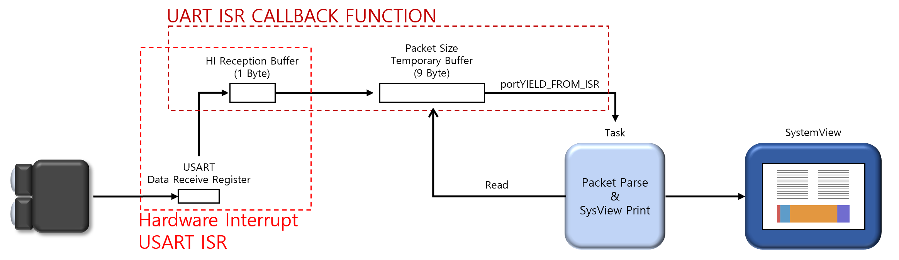
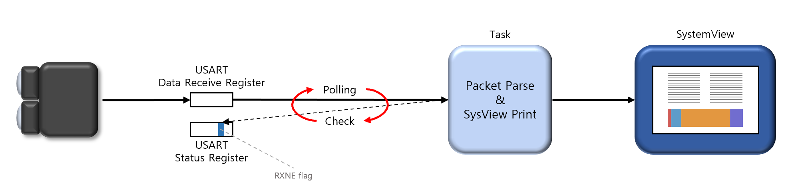
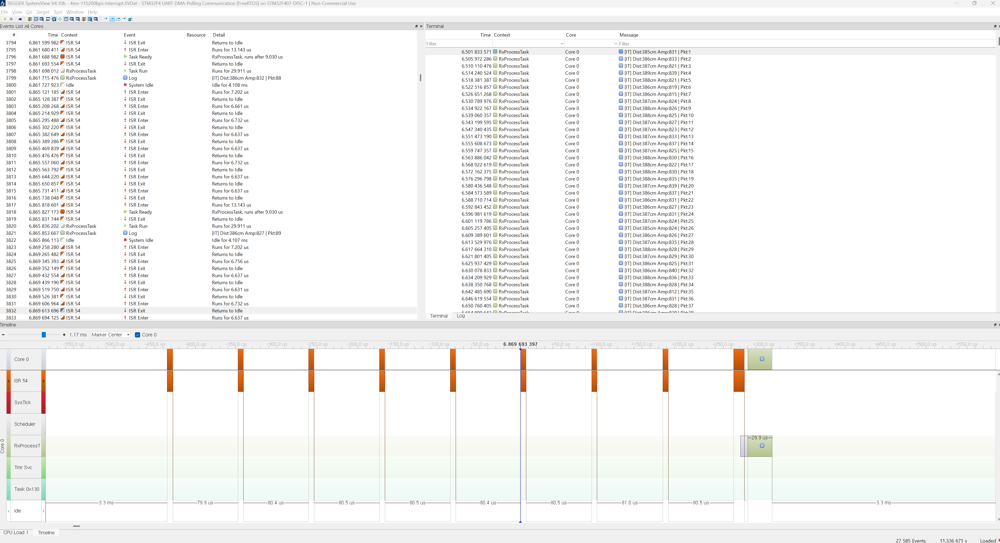
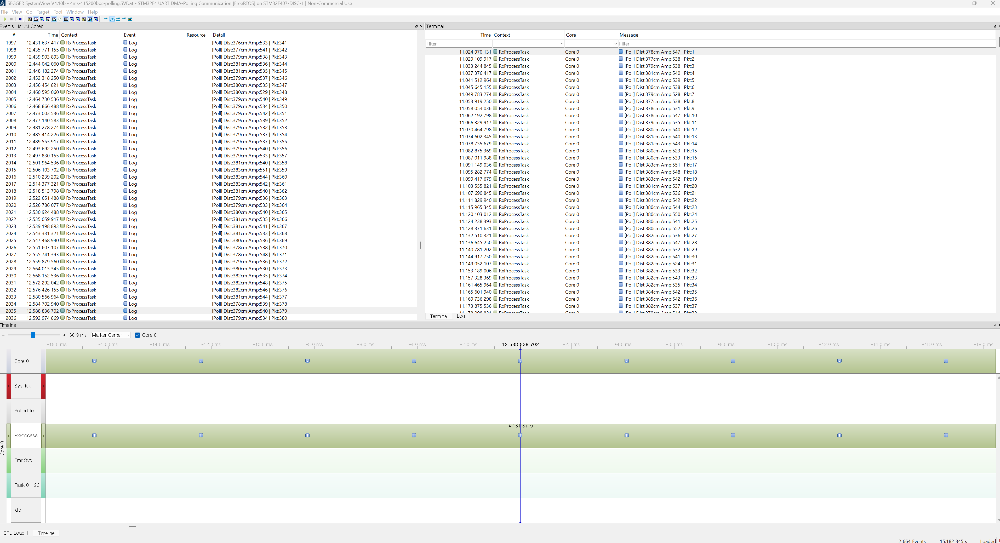
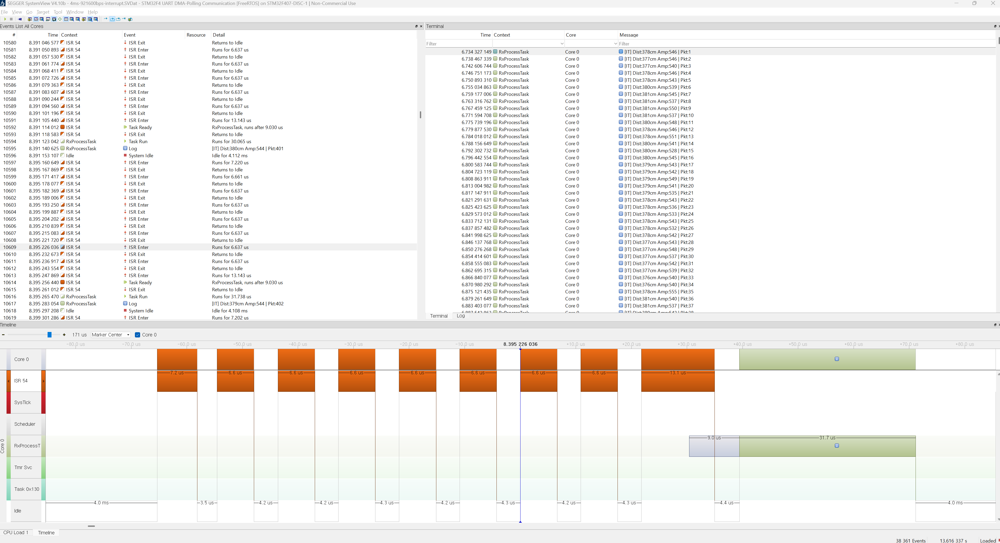
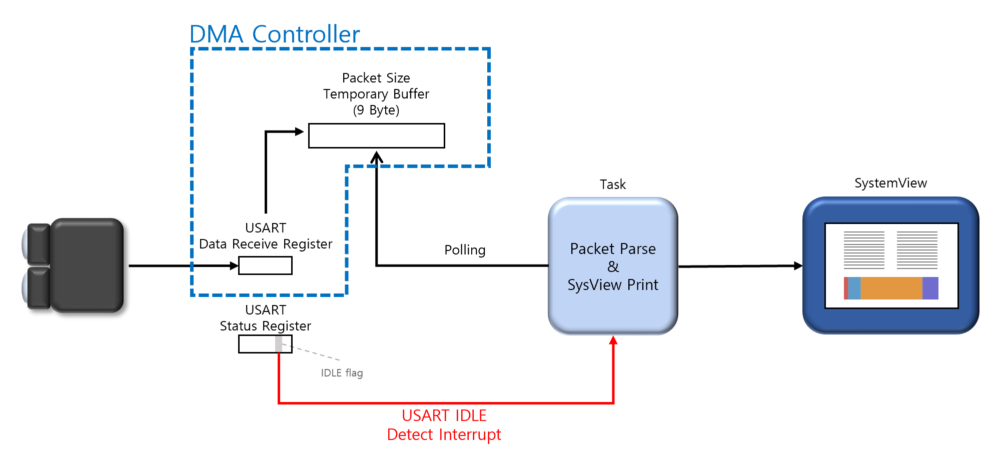
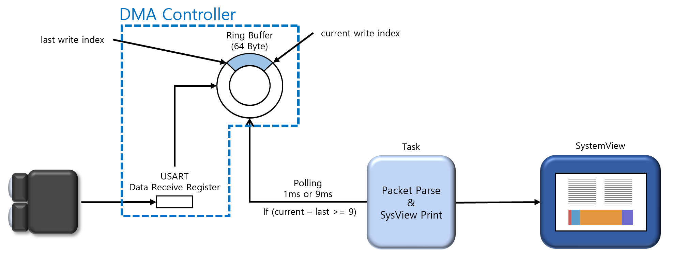
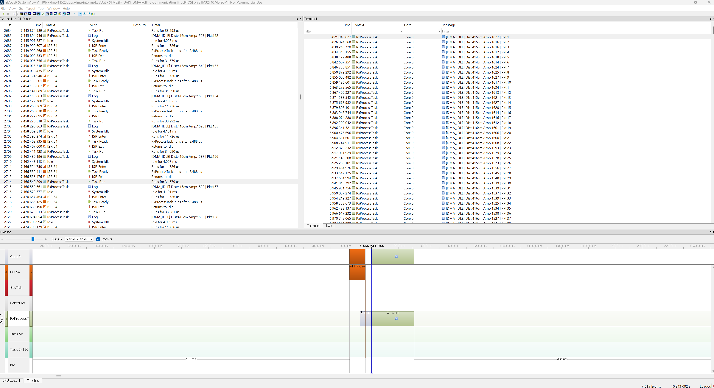
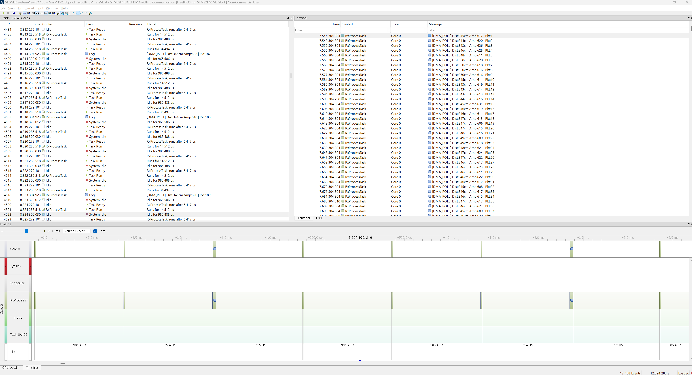
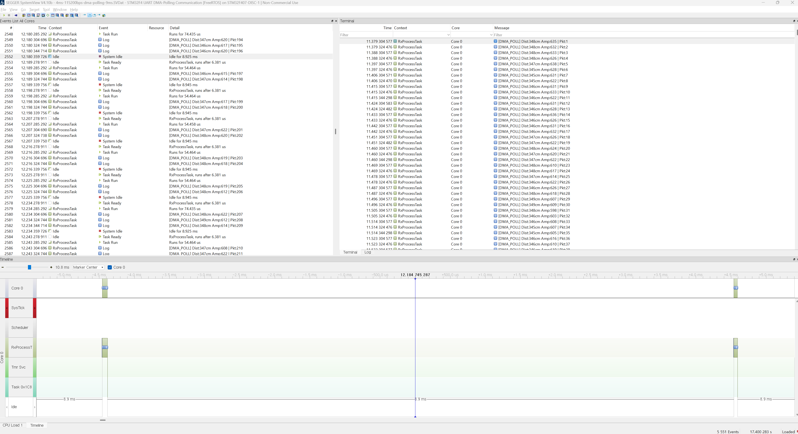

# Real-Time ADCP (Adaptive DMA Communication Pipeline)

시스템 부하에 따라 수신 인터럽트를 동적으로 제어해 고우선순위 제어 Task의 Deadline을 지키는 실시간 통신 파이프라인
- 본 프로젝트는 제한된 자원(ex. CPU Core 1개)으로 예측 불가능한 실행 고부하 상황에서 발생할 수 있는 시스템 지연을 원천 차단하기 위해 설계. 통신 패킷이 짧은 주기로 쏟아지는 환경에서도 수신 인터럽트(ISR)의 간섭을 능동적으로 통제함으로써, 고우선순위 핵심 제어 태스크가 어떠한 방해 없이 안전하게 실행 마감 시간(Deadline)을 지키도록 보장.
> 최종 목표는 시스템 부하에 따라 **DMA + IDLE Interrupt(저부하)** 와 **DMA + Polling(고부하)** 을 자동 전환하는 것입니다.

<!-- TODO: 소스 코드(STM32CubeIDE 프로젝트) 업로드 -->

### 진행 상태

| 단계 | 내용 | 상태 |
|---|---|---|
| 1 | 하드웨어 구성 (STM32F407 + TF-Luna) | ✅ 완료 |
| 2 | 순수 USART Interrupt / Polling 분석 | ✅ 완료 |
| 3 | DMA + IDLE Interrupt / DMA + Polling 구현 | 🔄 테스트 중 |
| 4 | Multi-Tasking 고부하 시나리오 실험 | ⏳ 계획 |
| 5 | Adaptive 전환 메커니즘 | ⏳ 계획 |

## 목차

1. [About the Project](#1-about-the-project)
2. [Development Environment](#2-development-environment)
3. [Phase 1 — 순수 USART 수신 분석](#3-phase-1--순수-usart-수신-분석)
4. [Phase 2 — DMA 기반 아키텍처](#4-phase-2--dma-기반-아키텍처)
5. [Phase 3 — Multi-Tasking 환경의 문제](#5-phase-3--multi-tasking-환경의-문제)
6. [Roadmap](#6-roadmap)
7. [Known Issues](#7-known-issues)
8. [License](#8-license)

---

## 1. About the Project

### 배경

- 일반적인 임베디드 시스템은 센서 데이터를 받을 때 **바이트마다 하드웨어 인터럽트**를 발생시키거나, 상태를 **계속 확인(Polling)** 해야 합니다.
- 통신 속도가 빨라질수록 바이트당 처리 허용 시간이 줄어 Overrun 위험이 커집니다.
- Multi-Tasking RTOS 환경에서는 잦은 수신 인터럽트가 핵심 제어 Task의 실행을 방해해 Deadline Miss로 이어질 수 있습니다.

### 핵심 전략

| 전략 | 설명 | 상태 |
|---|---|---|
| **DMA 수신** | CPU 개입 없이 DMA가 센서 데이터를 메모리(링 버퍼)에 직접 적재 | ✅ |
| **Sliding Window 파싱** | Byte Stream에서 헤더를 추적해 쪼개진 패킷과 노이즈 속에서도 프레임 경계를 복구 | ✅ |
| **Adaptive 인터럽트 제어** | 저부하에는 인터럽트로 빠르게 응답, 고부하에는 수신 인터럽트를 차단하고 Task 기반 Batch Processing으로 전환 | ⏳ |

---

## 2. Development Environment

| 구분 | 내용 |
|---|---|
| MCU / Board | STM32F407G-DISC1 (D-Cache가 없어 DMA Cache Coherency 문제 가능성 낮음) |
| Sensor | TF-Luna LiDAR (1D 거리 측정, UART) |
| IDE | STM32CubeIDE 1.19.0 (STM32CubeMX `.ioc` 통합) |
| RTOS | FreeRTOS v202411.00 |
| Profiling | SEGGER SystemView V4.10b (J-Link, Continuous Mode 기록) |
| Sensor Tool | Benewake LiDAR Viewer (TF-Luna Frame Rate, Baud Rate 설정) |

### TF-Luna 패킷 규격 (UART, 9 Byte)

| Byte | Field | 설명 | 값 |
|---|---|---|---|
| 0 | Header 1 | Frame Start | `0x59` |
| 1 | Header 2 | Frame Start | `0x59` |
| 2 – 3 | Dist_L / Dist_H | 거리 | `Dist_L \| (Dist_H << 8)` |
| 4 – 5 | Strength_L / Strength_H | 신호 세기 | `Strength_L \| (Strength_H << 8)` |
| 6 – 7 | Temp_L / Temp_H | 내부 온도 | `(Temp_L \| (Temp_H << 8)) / 8.0 - 256.0` (°C) |
| 8 | Checksum | 앞 8바이트 합의 하위 8bit | `(Byte0 + … + Byte7) & 0xFF` |

🔌 하드웨어 구성 (전원 · 핀 · 클럭 · 통신 설정)

#### 전원

| Hardware | Voltage | 전류 | 설명 |
|---|---|---|---|
| 9V 1A Adapter | 9V | 최대 1A 공급 | 220V → 9V |
| HW-131 Power Module | 5V / 3.3V | 최대 700mA 공급 | 9V → 5V / 3.3V |
| TF-Luna LiDAR | 5V (통신 3.3V) | 평균 70mA / 최대 150mA | 전원 5V, MCU와 통신 3.3V |
| STM32F407G-DISC1 | 3.3V | 핀당 최대 20 ~ 25mA | 메인 보드 |

#### 핀 배치

| Hardware | STM32F407 Pin | Breadboard |
|---|---|---|
| TF-Luna LiDAR | RXD → PA2 (USART2_TX) / TXD → PA3 (USART2_RX) | GND → (−) / VCC 5V → (+) |
| Common GND | GND | GND |

#### MCU 클럭

| Bus | Frequency | Peripheral |
|---|---|---|
| AHB1 (SYSCLK) | 168 MHz | – |
| APB1 | 42 MHz | PA2 (AF7: USART2_TX) / PA3 (AF7: USART2_RX) |

#### TF-Luna 통신 설정

| 구분 | Frame Rate | Baud Rate | 바이트 도착 간격 |
|---|---|---|---|
| 저속 | 250 Hz (4 ms) | 115,200 bps | 약 86.8 µs |
| 고속 | 250 Hz (4 ms) | 921,600 bps | 약 10.85 µs |

---

## 3. Phase 1 — 순수 USART 수신 분석

기존 Interrupt / Polling 방식의 한계를 SystemView로 확인했습니다.

| Interrupt | Polling |
|---|---|
|  |  |

### SystemView 캡처

|Frame Rate / Baud Rate|Interrupt|Polling|
|---|---|---|
|4ms / 115200bps|||
|4ms / 921600bps|||

### 방식별 비교

| 방식 | 동작 | 저속 (115,200 bps) | 고속 (921,600 bps) |
|---|---|---|---|
| **Interrupt** | 바이트마다 RXNE 인터럽트 → ISR에서 1바이트씩 수집 | 패킷당 9회 인터럽트 (86.8 µs 간격) | 패킷당 9회 인터럽트. ISR이 약 6.5 ~ 6.6 µs라 **10.85 µs 안에 응답하지 못하면 ORE** |
| **Polling** | `RXNEIE` 비활성화, CPU가 RXNE 플래그를 Spin Wait하며 DR에서 직접 읽음 | 86.8 µs 이내로 확인해야 ORE 방지 | 10.85 µs 이내로 확인해야 해서 ORE 위험 증가 |

### 문제점

- **CPU 낭비**: 바이트마다 인터럽트가 발생하거나(Interrupt), USART 수신 버퍼가 1바이트뿐이라 수신 내내 플래그를 감시해야 함(Polling)
- **Overrun 위험**: USART 수신 버퍼가 1바이트뿐이라(하드웨어 FIFO 없음) 다음 바이트가 오기 전에 읽지 못하면 ORE 발생
- **고속에서 더 위험**: 초당 수신 바이트 수는 같지만 바이트당 허용 시간이 86.8 µs에서 10.85 µs로 줄어, RTOS critical section이나 다른 ISR로 인해 응답이 조금만 늦어도 ORE 발생 가능

<!-- TODO: SystemView 캡처와 측정 수치(ISR 횟수, CPU 사용률, ORE 발생 여부) 추가 -->

---

## 4. Phase 2 — DMA 기반 아키텍처

고속 통신에서의 Overrun과 CPU 소모 문제를 해결하기 위해 DMA를 도입했습니다.

| DMA + IDLE Interrupt | DMA + Polling |
|---|---|
|  |  |

### SystemView 캡처

|Frame Rate / Baud Rate|Interrupt|Polling 1ms|Polling 9ms|
|---|---|---|---|
|4ms / 115200bps||||
|4ms / 921600bps|||

### 두 방식 비교

| 항목 | DMA + IDLE Interrupt | DMA + Polling (1 ms / 9 ms) |
|---|---|---|
| 동작 | DMA가 버퍼에 적재, 패킷 수신 후 IDLE line 감지 시 인터럽트 1회 | DMA가 Circular 링 버퍼(64 B)에 계속 적재, Task가 주기적으로 인덱스 확인 후 Batch 처리 |
| CPU 알림 | 패킷당 1회 (4 ms마다) | 인터럽트 없음 |
| 장점 | 패킷 도착 즉시 처리 → 응답성 높음 | Task가 원하는 시점에 처리 → 고우선순위 Task 간섭 없음 |
| 비고 1 | 바이트 단위 인터럽트 대비 인터럽트 수 1/9 | 1 ms: 4번 중 1번 데이터 있음 / 9 ms: 매번 2 ~ 3개 패킷 적재 |
| 비고 2 | - | - |

### 파싱 알고리즘 (DMA + Polling 방식 해당)

| 기법 | 설명 |
|---|---|
| **Producer-Consumer** | DMA(생산자)가 CPU 개입 없이 링 버퍼에 적재하고, Task(소비자)가 주기적으로 깨어나 쌓인 만큼만 소비 |
| **Sliding Window** | `read_idx`를 1바이트씩 옮기며 헤더(`0x59 0x59`)를 찾고, 체크섬이 틀린 패킷은 버림 |
| **Frame Resync** | TCP처럼 경계 없는 Byte Stream에서 9바이트 프레임을 다시 조립 |

<!-- TODO: 링 버퍼 크기(64 B)와 허용 가능한 최대 Polling 주기 관계 명시 (64 B ≈ 7 패킷 ≈ 28 ms) -->

---

## 5. Phase 3 — Multi-Tasking 환경의 문제

DMA로 통신상의 데이터 유실은 해결했지만, 실제 제어 시스템에는 다음과 같은 동적 변수가 있습니다.

- **다중 Task 우선순위 간섭**: 통신보다 우선순위가 높은 제어 Task들의 실행 시간이 상황에 따라 계속 변함
- **고정 주기 처리의 낭비**: 드론·로봇은 상황에 따라 필요한 데이터 빈도가 다름(충돌 위험이 낮으면 저빈도, 근접 시 고빈도). 4 ms마다 항상 즉시 처리하는 것은 낭비
- **검증 필요**: 제어 Task의 동적 부하와 가변 수신 주기가 섞인 환경에서 DMA + Interrupt와 DMA + Polling이 시스템 안정성에 미치는 영향 비교 필요

---

## 6. Roadmap

### 6.1 Multi-Tasking 시나리오 실험

우선순위가 높은 Dummy Task 여러 개로 부하를 만들어 SystemView로 검증할 예정입니다.

| 시나리오 | 조건 | 검증할 가설 |
|---|---|---|
| 저부하 | 패킷 주기 길게, 제어 Task 여유 있음 | 두 방식 모두 최상위 Task에 지장 없음 |
| 고부하 | 패킷 주기 짧게, 고우선순위 Task 실행 시간 김 | DMA + Interrupt는 간섭으로 Deadline Miss 유발, DMA + Polling은 Deadline 유지 |

### 6.2 Adaptive 파이프라인

- **고부하 전환 기준 (Trigger)**: LiDAR 측정 거리 **1m 미만** (근접 위험 구역 진입 시)
- **적응형 전환 메커니즘 (Adaptive Switch)**:
  1. **부하 증가 감지**: 타겟(장애물)이 1m 이내로 근접하면, 회피 궤적 계산 및 모터 튜닝 등 최우선순위 제어 Task들의 연산량이 급증하며 실행 시간이 길어집니다. (우선순위가 높은 Dummy Task로 진행하게 되므로 LiDAR의 측정 거리가 1m 미만이 되면 점진적으로 실행 시간을 늘리는 방식으로 진행할 예정)
  3. **Deadline Miss 위험 차단**: 이때 기존의 `DMA + Interrupt` 방식을 유지하면 잦은 수신 ISR이 제어 Task를 강제로 간섭(Preemption)하여 치명적인 Deadline Miss를 유발할 수 있습니다. (Deadline을 넘긴 Dummy Task는 그 횟수를 기록)
  4. **Interrupt 마스킹 및 Polling 전환**: 시스템은 즉각 UART 수신 인터럽트를 차단하고 `DMA + Polling` 모드로 전환합니다.
  5. **Deadline 보장**: 고우선순위 제어 Task들이 어떤 인터럽트의 방해도 받지 않고 안전하게 Deadline 내에 연산을 마칩니다. 이후 하위 우선순위의 통신 Task가 스케줄링되어 깨어날 때, DMA 링 버퍼에 안전하게 쌓여있던 패킷들을 한 번에 일괄 파싱(Batch Processing)합니다.

| 모드 | 방식 | 동작 |
|---|---|---|
| 저부하 | DMA + IDLE Interrupt | 패킷 도착 즉시 처리해 빠른 응답성 확보, 패킷 주기를 길게 설정 |
| 고부하 | DMA + Polling | UART 수신 인터럽트(IDLE 포함)를 차단하고, 넉넉한 링 버퍼로 통신 Task 주기를 늦춘 뒤 남는 시간에 Batch 처리 |

<!-- TODO: 고부하 판단 기준(예: idle task 실행 비율) 정의 -->

**최종 목표**: 시스템 부하와 외부 환경에 맞춰 통신 전략을 동적으로 전환해 고우선순위 Task의 Deadline을 지키는 시스템 완성

### 체크리스트

- [ ] 921,600 bps DMA 측정 (`sysview_record/4ms-921600bps-DMA/`)
- [ ] 고우선순위 Dummy Task 기반 부하 실험
- [ ] 부하 감지 및 모드 자동 전환 구현
- [ ] 방식별 ISR 횟수 · CPU 사용률 · Deadline Miss 비교표 작성

---

## 7. Known Issues

| 문제 | 상태 |
|---|---|
| STM32F4에서 보낸 TF-Luna 주기 변경 명령이 적용되지 않음 | 🔄 해결 중 |

---

## 8. License

MIT License — [LICENSE](LICENSE) 참조

📁 SystemView 기록 파일

`sysview_record/` 폴더의 `.SVDat` 파일은 SEGGER SystemView에서 `File → Load Data`로 열 수 있습니다.

| 폴더 | 내용 |
|---|---|
| `4ms-115200bps/` | 저속 Interrupt / Polling |
| `4ms-921600bps/` | 고속 Interrupt / Polling |
| `4ms-115200bps-DMA/` | 저속 DMA + Interrupt, DMA + Polling (1 ms / 9 ms) |
| `4ms-921600bps-DMA/` | 측정 예정 |

